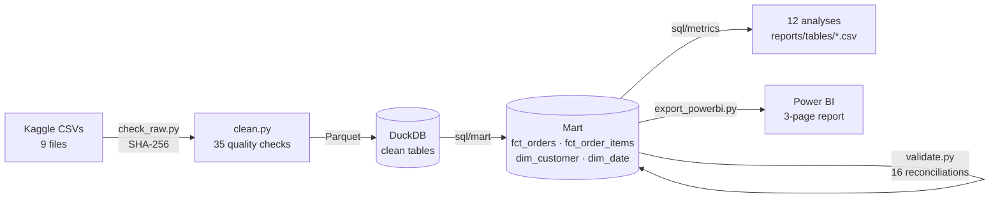

# E-commerce Orders, Delivery & Customer Analytics (Olist)

End-to-end analytics project on ~100k marketplace orders: **Python data-quality pipeline → SQL data mart and
12 analyses → Power BI dashboard → one-page business brief.**
Independent practice project on public historical Brazilian data. It is not client work and makes no claims of
business impact.

## Business questions

1. How are orders and product value trending, and which categories drive them?
2. How reliable is delivery, where is it late, and how does lateness relate to customer reviews?
3. Do customers come back, and how quickly?

## Key results (complete months 2017-01 to 2018-08)

| Metric | Value |
|---|---|
| Valid orders / product value | 97,910 orders · BRL 13.45 m |
| Average order value (product) | BRL 137.37 |
| Late-delivery rate | 6.8% overall; 19.0% in 2018-03; 4.1% (PR) to 21.5% (AL) by state |
| Review score, 8+ days late vs 10+ days early | 1.70 vs 4.32 stars |
| Customers buying on 2+ different days | 2.2% (median 74 days to the second purchase) |
| Top 10% of sellers' share of product value | 67.4% |

Full write-up: **[analysis brief](reports/analysis_brief.md)** (3 findings, 2 recommendations, limitations).

## Pipeline



### Design decisions worth knowing

- **Grain first.** `order_items`, `payments` and `reviews` each have many rows per order. Joining them directly
  inflates payment value by 27.9% ([`sql/checks/fanout_demo.sql`](sql/checks/fanout_demo.sql)). The mart aggregates
  each child table to one row per order before joining, and [`src/validate.py`](src/validate.py) reconciles row
  counts and money totals with the source tables.
- **Honest metric names.** "Product value" (item prices) and "payment value" are reported separately and never
  called revenue: the data has no commission or cost fields.
- **Complete months only.** 2016 and 2018-09/10 are partial collection periods, so they are excluded from trends.
  Month-over-month growth is only computed between consecutive complete months.
- **Repeat purchase = a later calendar day.** 869 of 2,888 people with 2+ orders only reordered on the same day
  (split baskets). Counting those would overstate repeat purchase by ~40%.
- **Cohorts respect the observation window.** A cohort that cannot yet be observed for N months shows blank, not 0%.
- **Late = delivered on a later calendar day than the estimate**, because the estimate has no time of day.

Definitions: [metric definitions](docs/metric_definitions.md) · [data dictionary](docs/data_dictionary.md) ·
[ER diagram & grain](docs/er_diagram.md) · [data quality report](reports/data_quality_report.md) ·
[Power BI model & DAX](docs/powerbi.md)

## SQL analyses ([`sql/metrics/`](sql/metrics))

| # | Analysis | Techniques |
|---|---|---|
| 01 | Monthly orders, product value, freight, MoM growth | CTE pre-aggregation, `LAG`, gap-safe MoM |
| 02 | Average order value: product vs payment | Two child tables aggregated before join, median |
| 03 | Delivery time and late rate by month | Date arithmetic, conditional aggregation |
| 04 | Category mix and concentration | `RANK`, running share with `SUM() OVER` |
| 05 | Delivery and reviews by state | Ranking, small-sample flag |
| 06 | Review score by delivery outcome | Bucketing, share of total with window sum |
| 07 | Repeat purchase | Person-level identifier, visit-day definition |
| 08 | Monthly cohort repeat rates | Cohorts, cumulative windows, observation cut-off |
| 09 | Seller concentration (deciles) | `NTILE`, cumulative share |
| 10 | Payment methods and instalments | Largest-payment attribution, `ROW_NUMBER` |
| 11 | New vs returning orders by month | `FILTER` conditional aggregation |
| 12 | Same-state vs interstate delivery | `HAVING`, route classification |

## Power BI dashboard

Three pages: **Overview** (orders, product value, AOV, category mix), **Delivery & Reviews** (late rate by month
and state, review score by delivery outcome) and **Customers** (returning-order share, cohort table, payment mix).
The project is saved in the text-based PBIP format ([`powerbi/`](powerbi)), so the model, relationships and DAX
can be reviewed in Git. Model details and DAX: [`docs/powerbi.md`](docs/powerbi.md).

*Screenshots: see [`reports/figures/`](reports/figures).*

## Reproduce

Requires Python 3.12 and, for the dashboard, Power BI Desktop (Windows).

```powershell
python -m venv .venv
.venv\Scripts\Activate.ps1
pip install -r requirements.txt

# 1. Data: Kaggle API token in %USERPROFILE%\.kaggle\ (access_token or kaggle.json), then
kaggle datasets download -d olistbr/brazilian-ecommerce -p data/raw --unzip
python src/check_raw.py            # files present + SHA-256 (compare with docs/data_source.md)

# 2. Pipeline
python src/clean.py                # 35 checks -> clean Parquet + reports/data_quality_report.md
python src/build_db.py             # DuckDB clean tables + mart (sql/mart/*.sql)
python src/validate.py             # 16 reconciliation checks, exits 1 on failure
python src/run_sql.py "sql/checks/*.sql" "sql/metrics/*.sql"   # results -> reports/tables/*.csv

# 3. Dashboard
python src/export_powerbi.py       # mart -> data/processed/powerbi/*.parquet
python src/build_powerbi_project.py  # sets the DataFolder parameter to this machine's path
# open powerbi/OlistDashboard.pbip in Power BI Desktop and click Refresh
```

## Project structure

```
├── docs/            data source & licence, data dictionary, ER diagram, metric definitions, Power BI notes
├── sql/
│   ├── mart/        order mart, item fact, customer and date dimensions
│   ├── metrics/     12 analyses
│   └── checks/      fan-out demonstration, Power BI expected values
├── src/             check_raw, clean, build_db, validate, run_sql, export_powerbi, build_powerbi_project
├── powerbi/         OlistDashboard.pbip (TMDL semantic model + PBIR report)
├── reports/         analysis brief, data quality report, result tables, figures
└── data/            raw and processed data (not committed)
```

## Data and licence

[Brazilian E-Commerce Public Dataset by Olist](https://www.kaggle.com/datasets/olistbr/brazilian-ecommerce),
licensed **CC BY-NC-SA 4.0**. Data © Olist; used here for non-commercial learning. Raw data is not redistributed.
Download date, version and checksums: [`docs/data_source.md`](docs/data_source.md).

## Limitations

Historical 2016–2018 data from one Brazilian marketplace. There are no cost, margin, marketing or traffic fields,
and relationships are associations, not causal effects. See the [analysis brief](reports/analysis_brief.md#limitations).
