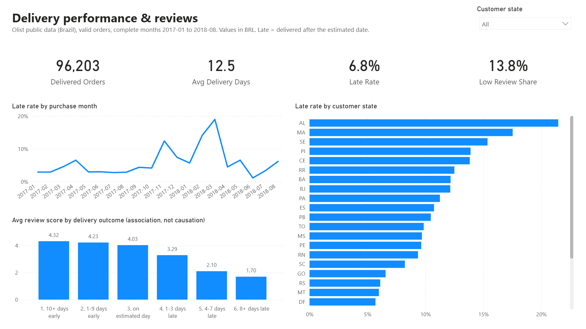
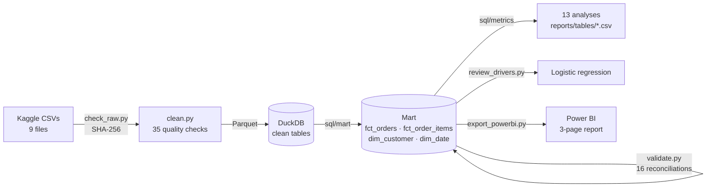
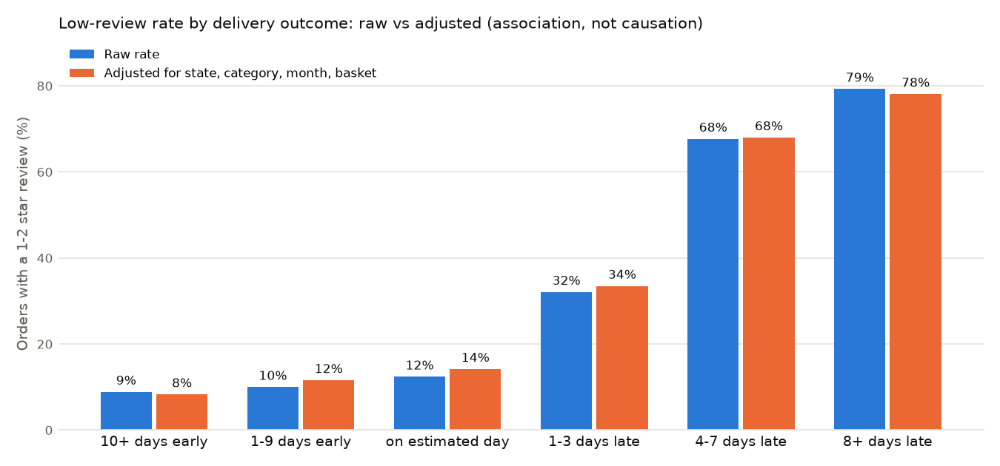
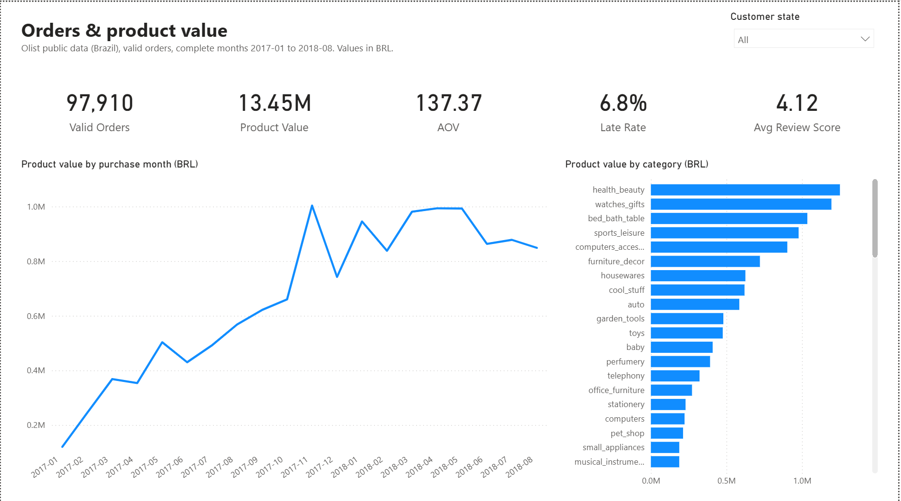
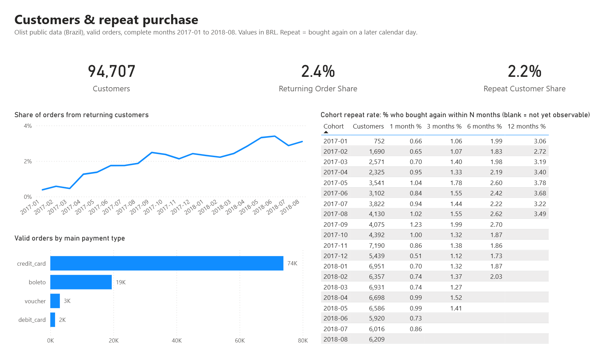

# E-commerce Orders, Delivery & Customer Analytics (Olist)

**What drives bad customer reviews on a marketplace, and where should operations act first?**
An end-to-end analysis of 100k orders: Python data-quality pipeline, a reconciled SQL data mart, 13 SQL analyses,
a logistic regression, a 3-page Power BI dashboard and a one-page business brief.

**Python · SQL (DuckDB) · Power BI (DAX, star schema) · statsmodels** — independent practice project on public,
historical Brazilian data; not client work and no claims of business impact.



## Key findings

1. **Late delivery goes with very poor reviews, and region, product or season do not explain it.**
   Orders delivered 8+ days late get a 1–2 star review 79% of the time, against 9% for orders that arrive 10+ days
   early. After a logistic regression controls for state, category, month and basket, the rates are 78% vs 8%.
2. **Split orders fail through missing items, not lateness.** Orders from several sellers are almost never late
   (1%), yet 47% get a 1–2 star review. Of their low reviews with a comment, 56% mention an item that never
   arrived, against 21% for single-item orders.
3. **97.8% of customers buy only once.** Customers who do return take a median of 74 days. The 12-month cohort
   repeat rate is 2.7–3.8%.

→ Full write-up with recommendations and limitations: **[analysis brief](reports/analysis_brief.md)**

| Headline numbers (complete months 2017-01 to 2018-08) | |
|---|---|
| Valid orders · product value · average order value | 97,910 · BRL 13.45 m · BRL 137.37 |
| Late-delivery rate | 6.8% overall · 19.0% peak (2018-03) · 4.1% (PR) to 21.5% (AL) by state |
| Top 10% of sellers' share of product value | 67.4% |

## How the numbers are made trustworthy



- **Grain first.** `order_items`, `payments` and `reviews` each have many rows per order. Joining them directly
  inflates payment value by 27.9% ([`sql/checks/fanout_demo.sql`](sql/checks/fanout_demo.sql)). The mart aggregates
  each child table to one row per order before joining, and [`src/validate.py`](src/validate.py) reconciles row
  counts and money totals with the source tables.
- **Dashboard reconciled to SQL.** Every Power BI card is checked against
  [`sql/checks/powerbi_expected_kpis.sql`](sql/checks/powerbi_expected_kpis.sql). That check caught a DAX bug:
  `review_score <= 2` counted unreviewed orders as low reviews, because `BLANK() <= 2` is TRUE in DAX.
- **Honest metric names.** "Product value" (item prices) and "payment value" are reported separately and never
  called revenue, because the data has no commission or cost fields.
- **Repeat purchase = a later calendar day.** 869 of 2,888 people with 2+ orders only reordered on the same day
  (split baskets). Counting them would overstate repeat purchase by ~40%.
- **Cohorts respect the observation window.** A cohort that cannot yet be observed for N months shows blank, not 0%.
- **Complete months only.** 2016 and 2018-09/10 are partial collection periods, so they are excluded from trends.
  Month-over-month growth is only computed between consecutive complete months.
- **Late = delivered on a later calendar day than the estimate**, because the estimate has no time of day.

Definitions: [metric definitions](docs/metric_definitions.md) · [data dictionary](docs/data_dictionary.md) ·
[ER diagram & grain](docs/er_diagram.md) · [data quality report](reports/data_quality_report.md) ·
[Power BI model & DAX](docs/powerbi.md)

## Analyses

| # | Analysis | Techniques |
|---|---|---|
| 01 | Monthly orders, product value, freight, MoM growth | CTE pre-aggregation, `LAG`, gap-safe MoM |
| 02 | Average order value: product vs payment | Two child tables aggregated before join, median |
| 03 | Delivery time and late rate by month | Date arithmetic, conditional aggregation |
| 04 | Category mix and concentration | `RANK`, running share with `SUM() OVER` |
| 05 | Delivery and reviews by state | Ranking, small-sample flag |
| 06 | Review score by delivery outcome | Bucketing, share of total with window sum |
| 07 | Repeat purchase | Person-level identifier, visit-day definition |
| 08 | Monthly cohort repeat rates | Cohorts, cumulative windows, observation cut-off |
| 09 | Seller concentration (deciles) | `NTILE`, cumulative share |
| 10 | Payment methods and instalments | Largest-payment attribution, `ROW_NUMBER` |
| 11 | New vs returning orders by month | `FILTER` conditional aggregation |
| 12 | Same-state vs interstate delivery | `HAVING`, route classification |
| 13 | Split orders and missing-item complaints | Text pattern matching (`regexp_matches`) on reviews |
| — | Low-review drivers ([`src/review_drivers.py`](src/review_drivers.py)) | Logistic regression, odds ratios, adjusted rates |



## Power BI dashboard

Three pages: **Overview** (orders, product value, AOV, category mix), **Delivery & Reviews** (late rate by month
and state, review score by delivery outcome) and **Customers** (returning-order share, cohort table, payment mix).
The project uses the text-based PBIP format ([`powerbi/`](powerbi)), so the model, relationships and DAX can be
reviewed in Git. Model details and DAX: [`docs/powerbi.md`](docs/powerbi.md).




## Reproduce

Requires Python 3.12 and, for the dashboard, Power BI Desktop (Windows).

```powershell
python -m venv .venv
.venv\Scripts\Activate.ps1
pip install -r requirements.txt

# 1. Data: Kaggle API token in %USERPROFILE%\.kaggle\ (access_token or kaggle.json), then
kaggle datasets download -d olistbr/brazilian-ecommerce -p data/raw --unzip
python src/check_raw.py            # files present + SHA-256 (compare with docs/data_source.md)

# 2. Pipeline and analysis
python src/clean.py                # 35 checks -> clean Parquet + reports/data_quality_report.md
python src/build_db.py             # DuckDB clean tables + mart (sql/mart/*.sql)
python src/validate.py             # 16 reconciliation checks, exits 1 on failure
python src/run_sql.py "sql/checks/*.sql" "sql/metrics/*.sql"   # results -> reports/tables/*.csv
python src/review_drivers.py       # logistic regression -> reports/tables, reports/figures

# 3. Dashboard
python src/export_powerbi.py       # mart -> data/processed/powerbi/*.parquet
```

Then open `powerbi/OlistDashboard.pbip` in Power BI Desktop. Under **Transform data → Edit parameters**, set
`DataFolder` to your `data\processed\powerbi\` folder, and click **Refresh**. (`src/build_powerbi_project.py`
generated the first version of the project. Rerunning it overwrites the version saved in Desktop.)

## Project structure

```
├── docs/            data source & licence, data dictionary, ER diagram, metric definitions, Power BI notes
├── sql/
│   ├── mart/        order mart, item fact, customer and date dimensions
│   ├── metrics/     13 analyses
│   ├── models/      model dataset for the review-driver regression
│   └── checks/      fan-out demonstration, Power BI expected values
├── src/             pipeline, validation, SQL runner, review_drivers, Power BI export/scaffold
├── powerbi/         OlistDashboard.pbip (TMDL semantic model + PBIR report)
├── reports/         analysis brief, data quality report, result tables, figures
└── data/            raw and processed data (not committed)
```

## Data and licence

[Brazilian E-Commerce Public Dataset by Olist](https://www.kaggle.com/datasets/olistbr/brazilian-ecommerce),
licensed **CC BY-NC-SA 4.0**. Data © Olist; used here for non-commercial learning. Raw data is not redistributed.
Download date, version and checksums: [`docs/data_source.md`](docs/data_source.md).

## Limitations

Historical 2016–2018 data from one Brazilian marketplace. There are no cost, margin, marketing or traffic fields.
The regression adjusts only for observed factors, so its results are associations, not causal effects. See the
[analysis brief](reports/analysis_brief.md#limitations).
