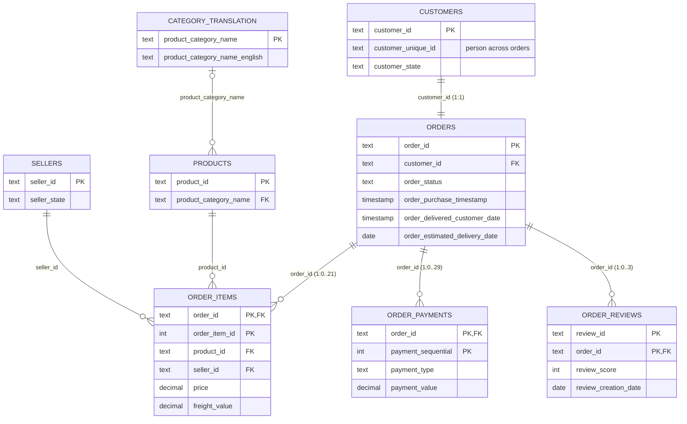

# ER diagram and table grain

Relationships verified on the raw data (no orphan foreign keys). GitHub renders the diagram below.

## Grain summary

| Table | One row = | Rows | Joins to `orders` |
|---|---|---|---|
| orders | one order | 99,441 | — |
| customers | one order's customer record | 99,441 | 1 : 1 on `customer_id` |
| order_items | one item unit in an order | 112,650 | many : 1 (1–21 per order; 775 orders have none) |
| order_payments | one payment record | 103,886 | many : 1 (1–29 per order; 1 order has none) |
| order_reviews | one (review, order) pair | 99,224 | many : 1 (1–3 per order; 768 orders have none) |
| products | one product | 32,951 | via order_items |
| sellers | one seller | 3,095 | via order_items |

## Why grain matters: join fan-out

`order_items`, `order_payments` and `order_reviews` are each *many rows per order*. Joining two of them
on `order_id` pairs every item with every payment, so an order with 2 items and 2 payments becomes 4 rows,
and any `SUM` over those rows double counts. Rule used in this project:

1. Aggregate each child table to **one row per order** first (CTE or a mart table).
2. Only then join to `orders`.
3. Check after every join: order count unchanged, money totals equal to the source table totals.

[`sql/checks/fanout_demo.sql`](../sql/checks/fanout_demo.sql) shows the inflation on the real data.
